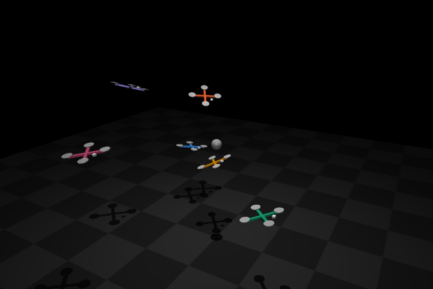
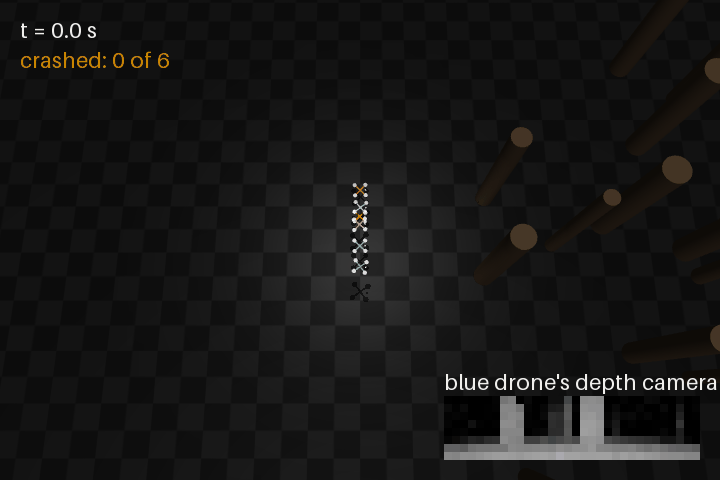

# quadjax

A quadrotor that learns to fly with reinforcement learning. The simulator and PPO are written from scratch in JAX, so thousands of drones train at once on one GPU. MuJoCo is the cross-check for the physics and the depth camera.

## Results

All numbers are from 1000 test episodes the policy never trained on, with randomized drones (mass and inertia ±20%, each motor ±10%, motor lag 20-50 ms).

**The sim matches MuJoCo.** Given the same thrust and torques for 3 s, the two stay within 0.022 mm in position and 0.0002 deg in attitude. Our depth raycaster matches MuJoCo's to well under 1 mm.

| Task | Policy sees | Crashed | Ends this far from target |
|---|---|---|---|
| Hover | its own state | 0% | under 1 cm |
| Waypoint (any point in a 3 x 3 x 1.5 m box, start at up to 2 m/s) | state + target | under 1% | about 3 cm |
| Forest (16 m through 30 random trunks) | noisy state + 32 x 8 noisy depth image | 7% | about 6 cm |
| Motor failure (one motor dies or weakens mid-flight) | state + motor health | 10% | about 12 cm |

| Hover | Waypoint |
|---|---|
|  |  |



Six random drones in a forest none of them has seen; the inset is the blue drone's depth image. Four make it, blue and pink hit trunks.

### Forest policy on forests it never trained on

| Forest | Crashed |
|---|---|
| As trained (30 trunks) | 7.7% |
| Sparse (fewer trunks) | 2.0% |
| Dense (45 trunks) | 18.3% |
| Very dense (60 trunks) | 28.8% |
| Thin trunks | 12.1% |
| Thick trunks | 21.4% |

To cut crashes, a wider network (128 units instead of 64) did best: 14.1% down to 7.2%. Training twice as long reached 9.2%. Feeding the last 3 depth frames instead of 1 made it worse (10.8%) on the same training budget.

### Safety filter

Before each action, the filter simulates "take this action, then brake and hold for 1.5 s". If that path touches a trunk, wall, ceiling or the ground (with 10 cm to spare), the drone brakes instead.

| Forest | Filter off | Filter, nominal drone as model | Filter, exact drone as model |
|---|---|---|---|
| 30 trunks | 7.1% | 7.6% | 0.0% |
| 45 trunks | 19.2% | 11.4% | 0.0% |
| 60 trunks | 29.5% | 12.6% | 0.0% |

With the exact drone as its model the filter never lets a crash through, but drones brake so much that only 81%, 67% and 47% reach the goal in 8 s. With the nominal drone the prediction is off by 11-21 cm on a randomized drone, and the filter helps much less. A filter that predicts is only as good as its model.

### Motor failure


Each drone loses a different motor completely at 1 s. Three survive by giving up on heading and spinning at about 5 turns per second, the known way a quadrotor stays up on three motors. Green drifts off and crashes.

| Thrust left on the failed motor | Crashed |
|---|---|
| 0% (dead) | 19% |
| 0-25% | 8% |
| 25-50% | 0% |

This needed two things: air drag against spinning in the sim (without it the spin grows forever), and a policy that decides 250 times a second instead of 50. At 50 Hz every dead-motor case crashed.

## Limits

- The motor-failure policy is told which motor failed. A real drone would have to work that out from how it moves.
- The safety filter uses the true tree map. A real drone would build it from its own depth frames.
- No policy has memory, so none can work out how heavy its drone is. That is the waypoint height error, and why the filter's model is off.
- The yaw drag strength is picked to give a plausible spin, not measured.
- Camera delay is not modeled.

## Running it

Needs an NVIDIA GPU and [uv](https://docs.astral.sh/uv/). Everything writes to `out/`.

```
uv sync
uv run python scripts/train.py forest    # train a task
uv run python scripts/watch_forest.py    # watch it fly
```

### Train and watch

`train.py <task>` trains with PPO, tests on 1000 new episodes and saves `out/<task>_params.pkl` and a learning curve. Each watch script needs its task trained first and saves a GIF. Times are on an RTX 3080 Laptop.

| Task | Train | Watch | Train time |
|---|---|---|---|
| Hover | `train.py hover` | `watch_hover.py` | 20 s |
| Waypoint | `train.py waypoint` | `watch_waypoint.py` | 50 s |
| Forest | `train.py forest` | `watch_forest.py` | 6 min |
| Motor failure | `train.py failure` | `watch_failure.py` | 4 min |

### Evaluate

| Script | What it does | Needs |
|---|---|---|
| `stress_forest.py [params]` | Forest policy on forests it never trained on: crash and reach rate per kind | forest |
| `shield_forest.py [params]` | Forest policy with the safety filter off, nominal and exact (5 min) | forest, waypoint |

### Check the sim

| Script | What it does | Correct looks like |
|---|---|---|
| `compare.py` | Same thrust and torques into our sim and MuJoCo for 3 s, saves `out/compare.png` | position gap under 1 mm, attitude under 0.01 deg |
| `check_depth.py` | Our depth raycaster vs MuJoCo's at 50 random poses, saves `out/depth.png` | largest gap under 1 mm |
| `fly.py` | One drone on fixed motor commands | hover holds z = 1.0000, climb rises about 0.46 m in 1 s |
| `bench.py` | Sim speed for 1 to 65536 drones | about 600,000 flight-seconds per second at 4096 drones |
