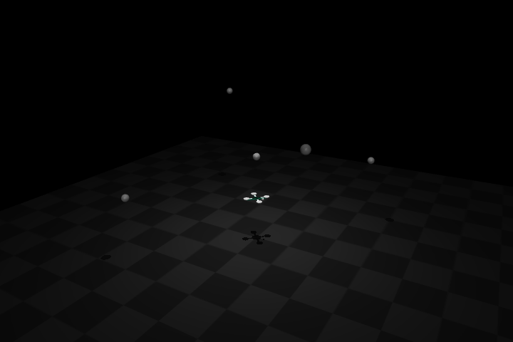
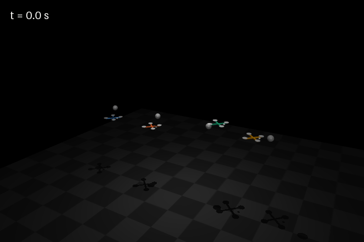

# quadjax

A quadrotor that learns to fly with reinforcement learning. The simulator and PPO are written from scratch in JAX, so thousands of drones train at once on one GPU. MuJoCo is the cross-check for the physics and the depth camera.

## Results

All numbers are from 1000 test episodes the policy never trained on, with randomized drones (mass and inertia ±20%, each motor ±10%, motor lag 20-50 ms).

**The sim matches MuJoCo.** Given the same thrust and torques for 3 s, the two stay within 0.022 mm in position and 0.0002 deg in attitude. Our depth raycaster matches MuJoCo's to well under 1 mm.

| Task | Policy sees | Crashed | Ends this far from target |
|---|---|---|---|
| Hover | its own state | 0% | under 1 cm |
| Waypoint (any point in a 3 x 3 x 1.5 m box, start at up to 2 m/s) | state + target | under 1% | about 3 cm |
| Forest (16 m through 30 random trunks) | noisy state + 32 x 8 noisy depth image | 7% | about 6 cm |
| Motor failure (one motor dies or weakens mid-flight) | state + motor health | 10% | about 12 cm |

| Hover | Waypoint |
|---|---|
|  |  |

Six random drones in a forest none of them has seen; the inset is the blue drone's depth image. Four make it, blue and pink hit trunks.

### Forest policy on forests it never trained on

| Forest | Crashed |
|---|---|
| As trained (30 trunks) | 7.7% |
| Sparse (fewer trunks) | 2.0% |
| Dense (45 trunks) | 18.3% |
| Very dense (60 trunks) | 28.8% |
| Thin trunks | 12.1% |
| Thick trunks | 21.4% |

To cut crashes, a wider network (128 units instead of 64) did best: 14.1% down to 7.2%. Training twice as long reached 9.2%. Feeding the last 3 depth frames instead of 1 made it worse (10.8%) on the same training budget.

### Safety filter

Before each action, the filter simulates "take this action, then brake and hold for 1.5 s". If that path touches a trunk, wall, ceiling or the ground (with 10 cm to spare), the drone brakes instead.

| Forest | Filter off | Filter, nominal drone as model | Filter, exact drone as model |
|---|---|---|---|
| 30 trunks | 7.1% | 7.6% | 0.0% |
| 45 trunks | 19.2% | 11.4% | 0.0% |
| 60 trunks | 29.5% | 12.6% | 0.0% |

With the exact drone as its model the filter never lets a crash through, but drones brake so much that only 81%, 67% and 47% reach the goal in 8 s. With the nominal drone the prediction is off by 11-21 cm on a randomized drone, and the filter helps much less. A filter that predicts is only as good as its model.

### Motor failure

Each drone loses a different motor completely at 1 s. Three survive by giving up on heading and spinning at about 5 turns per second, the known way a quadrotor stays up on three motors. Green drifts off and crashes.

| Thrust left on the failed motor | Crashed |
|---|---|
| 0% (dead) | 19% |
| 0-25% | 8% |
| 25-50% | 0% |

This needed two things: air drag against spinning in the sim (without it the spin grows forever), and a policy that decides 250 times a second instead of 50. At 50 Hz every dead-motor case crashed.

## Limits

- The motor-failure policy is told which motor failed. A real drone would have to work that out from how it moves.
- The safety filter uses the true tree map. A real drone would build it from its own depth frames.
- No policy has memory, so none can work out how heavy its drone is. That is the waypoint height error, and why the filter's model is off.
- The yaw drag strength is picked to give a plausible spin, not measured.
- Camera delay is not modeled.

## Scripts

- `uv run python scripts/fly.py`: flies one drone with fixed motor commands. Correct looks like: hover stays at z=1.0000, climb rises about 0.46 m in 1 s, and with the front-right motor at +5% it rolls and pitches negative (front-right side lifts) and drifts toward back-left (x negative, y positive).
- `uv run python scripts/compare.py`: gives our sim and MuJoCo the same thrust and torques for 3 s and saves `out/compare.png`. Correct looks like: the two lines overlap in every panel, the position gap stays well under 1 mm and the attitude gap under 0.01 deg.
- `uv run python scripts/bench.py`: steps 1 to 65536 drones at once for 2 s of flight and prints the speed. On an RTX 3080 Laptop, 4096 drones run about 600,000 flight-seconds per real second.
- `uv run python scripts/train.py hover`: trains the hover policy with PPO (about 20 s on the GPU), then tests it on 1000 new random starts. Saves `out/hover_curve.png`, `out/hover_curve.csv` and `out/hover_params.pkl`. Correct looks like: return climbs from near 0 to about 225 (250 is the max, the gap is time spent flying in from the start point), 0 crashes, and under 1 cm from the target after 5 s.
- `uv run python scripts/watch_hover.py`: needs `train.py hover` run first. Six trained drones fly in from random tilted starts; saves `out/hover.gif` (5 s). Correct looks like: all six reach the gray target ball within about 2 s and end stacked on it, still.
- `uv run python scripts/train.py waypoint`: trains a policy that flies to any point in a 3 x 3 x 1.5 m box from mid-flight (up to 2 m/s, tilted), on drones with randomized mass, inertia and motors (about 50 s). Correct looks like: return levels off near 155 of 200, a handful of crashes in 1000 (heavy drones starting low and diving), and about 3 cm from the target after 4 s. The 3 cm is mostly height: heavy drones sit a little low, because the policy has no memory to learn how heavy this drone is.
- `uv run python scripts/watch_waypoint.py`: needs `train.py waypoint` run first. A light, a normal and a heavy lopsided drone fly the same 5-waypoint course; prints arrival times and saves `out/waypoint.gif`. Correct looks like: all three reach 5/5, the heavy one a second or so behind, and all end holding on the last ball.
- `uv run python scripts/check_depth.py`: casts the depth camera's rays at 50 random poses in a random forest with our raycaster and with MuJoCo's, then saves `out/depth.png` (top view of the rays next to the 32 x 8 depth image). Correct looks like: the largest gap is well under 1 mm, and each bright column in the image lines up with a trunk hit by an orange ray.
- `uv run python scripts/train.py forest`: trains a policy that flies from x = 0 through a random 30-trunk forest to a goal at x = 16 m and holds there, seeing trees only through the depth image (about 6 min). Every sensor reading is noisy. Correct looks like: return climbs past 200, about 7 in 100 test drones crash (mostly into trunks), and the rest sit about 6 cm from the goal after 8 s.
- `uv run python scripts/watch_forest.py`: needs `train.py forest` run first. Six drones with random bodies fly the same new forest, seen from above; the inset is the blue drone's depth image. Prints each drone's outcome and saves `out/forest.gif`. Correct looks like: with the default seed, four make it and sit within about 9 cm of the goal, and blue and pink hit trunks at 2.3 and 2.4 s.
- `uv run python scripts/stress_forest.py [params]`: flies a trained forest policy through 1000 new forests of each kind it never trained on (fewer or more trunks, thinner or thicker trunks) and prints crash rate and how many reached the goal per kind.
- `uv run python scripts/shield_forest.py [params]`: needs `train.py forest` and `train.py waypoint` run first. Flies the forest policy with the safety filter off, on with the nominal drone as its model, and on with the exact drone flying as its model, in 1000 forests each of 30, 45 and 60 trunks (about 5 min). Correct looks like: with the exact drone the filter crashes 0 times in every forest, at the cost of drones that brake so often they don't reach the goal in 8 s. With the nominal drone it roughly halves crashes in the dense forests and barely changes them in the normal one: its predictions are off by 10-20 cm on a randomized drone.
- `uv run python scripts/train.py failure`: trains a policy that holds a point while one motor dies or drops to 0-50% thrust at a random moment, at 250 decisions per second (about 4 min). The policy is told each motor's health. Correct looks like: about 1 in 10 test drones crash, nearly all of them with a fully dead motor, and the rest end about 12 cm from the point after 6 s.
- `uv run python scripts/watch_failure.py`: needs `train.py failure` run first. Four drones each lose a different motor completely at 1 s; saves `out/failure.gif`. Correct looks like: the survivors spin at about 5 turns per second and hold within a few cm of their point (that spin is how a quadrotor with three motors stays up); with the default seed green drifts away and crashes at 4.3 s.
